  

  

<h1 align="center">
  
</h1>

  

 

 

🔭 Currently working on &nbsp;**shaping the future — one commit at a time**

🌱 Currently exploring &nbsp;**the bleeding edge of AI tooling, agentic workflows & what comes after REST**

💬 Ask me about &nbsp;**building fast, shipping clean, and knowing when done is done**

📫 Reach me at &nbsp;**dev@niepresjohn.com**

📄 Check my work at &nbsp;**[niepresjohn.com](https://niepresjohn.com)**

 

<h3 align="left">Connect with me:</h3>

  
  
  

 

<h2 align="center">⚒️ Languages · Frameworks · Tools ⚒️</h2>
 

**Frontend**

  

**Frontend Libraries & Tools**

  
  
  
  
  
  
  
  
  

**Backend**

  

**Databases**

  
  
  

**Testing & CI/CD**

  
  
  
  

**Cloud & Server Management**

  
  
  
  
  
  
  
  

**Platforms & Integrations**

  
  
  
  
  
  
  
  
  
  
  
  
  

**Analytics & Ads**

  
  
  

**Other Tools**

  
  
  
  
  

 

  <h2>🕹️ My Contributions 🕹️</h2>
   
  <picture>
    <source media="(prefers-color-scheme: dark)" srcset="https://raw.githubusercontent.com/NiepresJohn/niepresjohn/pacman/pacman-contribution-graph-dark.svg" />
    <source media="(prefers-color-scheme: light)" srcset="https://raw.githubusercontent.com/NiepresJohn/niepresjohn/pacman/pacman-contribution-graph.svg" />
    
  </picture>
     

<h2 align="center">⚡ Stats ⚡</h2>
 

  
    
  

  

 

  <h2>💡 "Building scalable solutions that matter, one commit at a time."</h2>
   
  Open to Freelance · Full-time · Remote · Based in Philippines (UTC+8)

